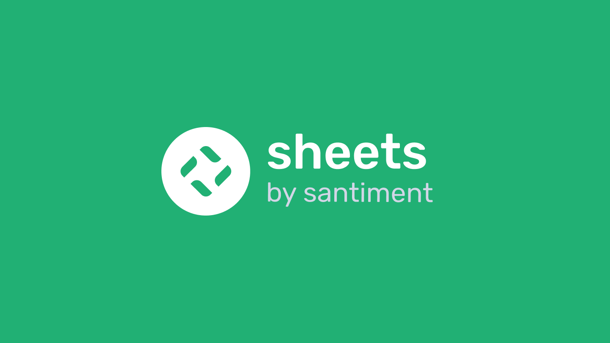

# Sheets landing page



This is the source for [`Sheets Landing Page`](https://sheets.santiment.net).

## Running locally

1. Use Node v22
2. pnpm V8.15.9 is needed. Install it first
3. To run the app:

```bash
pnpm i
pnpm dev
```

This is going to run the app on port 3000, so [`localhost:3000`](http://localhost:3000) should be accessible.
